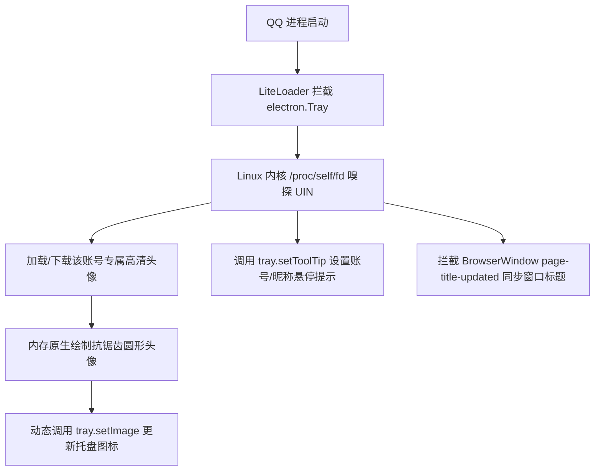

# LiteLoaderQQNT - Tray Account Indicator (托盘账号多开指示器)

<div align="center">

[](LICENSE)
[](#)
[](https://github.com/LiteLoaderQQNT/LiteLoaderQQNT)

**优雅解决 Linux QQ (NTQQ) 多账号多开时系统托盘图标雷同、悬停提示全为 `chrome_status_icon_1` 无法辨识的痛点问题。**

[English](#english) | [简体中文](#简体中文)

</div>

---

## 简体中文

### 痛点与背景

在 Linux 桌面（特别是 KDE Plasma、GNOME、XFCE 等）环境下，用户通常可以通过在任务栏 / Dock 的 QQ 图标上右键点击“新建窗口”实现多账号双开或多开。

然而，由于 Linux QQ 基于 Electron 构建，默认实现存在以下问题：
1. **托盘悬停提示无区分**：官方未为 Linux 托盘设置 `ToolTip`，KDE 等桌面组件被迫回退显示 Chromium 内部的唯一标识 `chrome_status_icon_1`。每一个独立 QQ 进程的编号均从 1 开始，导致**鼠标悬停在每个托盘图标上显示的内容完全相同**。
2. **托盘图标完全相同**：所有登录实例均显示默认企鹅图标，光靠肉眼无法分辨哪个是工作号、哪个是个人号。
3. **窗口预览无标识**：主窗口标题全为单调的 "QQ"，在 Dock 栏预览多窗口时难以精准定位目标窗口。

### 核心特性

- 🎯 **毫秒级内核账号识别**：直接读取 Linux 内核文件描述符（`/proc/self/fd`），精准、无延迟识别当前进程绑定的数字 QQ 号（UIN）。
- 💬 **动态托盘悬停提示（ToolTip & Title）**：将模糊的 `chrome_status_icon_1` 动态替换为 `QQ - 昵称 (账号)` 或 `QQ (账号)`。
- 🖼️ **高清圆角头像托盘（一眼秒辨）**：自动从官方 CDN 获取当前账号的高清头像，并在本地生成平滑抗锯齿的圆形/圆角托盘图标，无需鼠标悬停，用眼睛看图标即可秒认账号！
- 🪟 **任务栏 / Dock 预览联动**：实时拦截窗口标题刷新，将任务栏窗口标题同步更新为 `QQ - 昵称 (账号)`。
- ⚙️ **自定义备注别名**：支持在配置文件中为指定账号自定义备注（如“主账号”、“工作号”）。
- 🚀 **零外部依赖**：纯原生 Node.js / Electron 内存图像处理与 D-Bus 通信，极致轻量，安全稳定。

### 运行机制



### 安装使用

#### 1. 前置要求
- 确保系统已安装 **Linux QQ** 以及 **[LiteLoaderQQNT](https://github.com/LiteLoaderQQNT/LiteLoaderQQNT)** 插件框架。

#### 2. 一键安装插件
进入 LiteLoaderQQNT 的插件目录并克隆本仓库：

```bash
# 适用于常规安装或 Flatpak 安装的插件目录
mkdir -p ~/.config/LiteLoaderQQNT/plugins
cd ~/.config/LiteLoaderQQNT/plugins
git clone https://github.com/deadalux/LiteLoaderQQNT-Tray-Account-Indicator.git tray-account-indicator
```

#### 3. 增强 LiteLoader Hook（如尚未支持 onTrayCreated）
若你的 LiteLoaderQQNT 主框架尚未内置托盘监听钩子，只需在 `LiteLoaderQQNT/src/main/hook.js` 中的 `proxyElectron` 函数内增加对 `Tray` 的代理即可：

```javascript
function proxyTray(func) {
    return new Proxy(func, {
        construct(target, argArray, newTarget) {
            Runtime.triggerHooks("onTrayCreating", [target, argArray, newTarget]);
            const tray = Reflect.construct(target, argArray, newTarget);
            Runtime.triggerHooks("onTrayCreated", [tray]);
            return tray;
        }
    });
}

function proxyElectron(func) {
    return new Proxy(func, {
        get(target, property, receiver) {
            const module = Reflect.get(target, property, receiver);
            return property != "exports" ? module : new Proxy(module, {
                get(target, property, receiver) {
                    const exports = Reflect.get(target, property, receiver);
                    if (property === "BrowserWindow") return proxyWindow(exports);
                    if (property === "Tray") return proxyTray(exports); // 增加本行
                    return exports;
                }
            });
        }
    });
}
```

#### 4. 重启 QQ 生效
重启 QQ 或在 Dock 栏右键“新建窗口”，登录不同账号即可立即体验！

### 配置说明

插件首次运行后会在 `~/.config/LiteLoaderQQNT/data/tray_account_indicator/config.json` 生成配置文件：

```json
{
  "showAvatar": true,
  "customLabels": {
    "123456789": "工作号",
    "987654321": "大号"
  }
}
```
- `showAvatar`：是否使用用户头像替换系统托盘企鹅图标（默认 `true`）。
- `customLabels`：为指定数字 QQ 号设置自定义中文别名。

---

## English

### Problem Statement

On Linux desktop environments (e.g., KDE Plasma, GNOME, XFCE), users can launch multiple QQ instances by right-clicking the application dock icon and selecting "New Window".

However, because QQNT on Linux is built on Electron:
1. **Ambiguous Tooltip**: The official client does not set a tray `ToolTip`, causing desktop environments like KDE to fall back to the internal Electron D-Bus ID: `chrome_status_icon_1`. Each instance counts from 1, showing the exact same tooltip.
2. **Identical Icons**: Every logged-in instance renders the identical default Tux penguin icon.
3. **Identical Window Titles**: All window preview thumbnails on the dock are simply titled "QQ", making window management tedious.

### Features

- 🎯 **Kernel-level Account Detection**: Deterministically detects the account UIN via `/proc/self/fd` in sub-milliseconds without network latency.
- 💬 **Dynamic Tray Tooltip & Title**: Automatically sets `QQ - <Nickname> (<UIN>)` or customized labels.
- 🖼️ **High-DPI Circular Avatar Icon**: Downloads and smoothly clips the logged-in user's avatar as the tray icon.
- 🪟 **Dock & Taskbar Preview Sync**: Keeps the window title synchronized with the account info.
- ⚙️ **Custom Alias Support**: Define friendly aliases like "Work" or "Personal" in `config.json`.
- 🚀 **Zero External Dependencies**: Pure JavaScript / Node.js native buffer operations.

### Installation

Clone into your LiteLoaderQQNT plugins directory:

```bash
mkdir -p ~/.config/LiteLoaderQQNT/plugins
cd ~/.config/LiteLoaderQQNT/plugins
git clone https://github.com/deadalux/LiteLoaderQQNT-Tray-Account-Indicator.git tray-account-indicator
```

Restart QQ or launch a new window to enjoy distinct account indicators!

---

## License

This project is licensed under the [MIT License](LICENSE).
